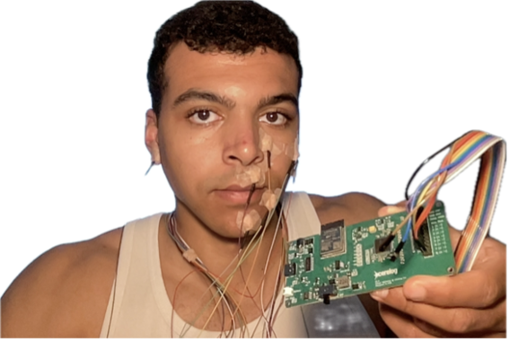

# sEMG Silent Speech Recognition: End-to-End Neural Decoding & LLM Post-Processing

[](https://www.python.org/)
[](https://pytorch.org/)
[]()
[]()
[](https://doi.org/10.5281/zenodo.4064408)

An end-to-end silent speech recognition pipeline mapping non-invasive facial surface electromyography (sEMG) directly into speech tokens and reconstructed natural language text.

This repository demonstrates a modular two-stage architecture evaluated across **three neural inductive biases** (1D CNN, biLSTM, Transformer), **two decoding granularities** ([CENSORED] intermediate acoustic unit vs. word), and **two speaking modes** (vocalized vs. silent speech) under a strictly zero-leakage unseen-vocabulary protocol.

---

> 🔒 **Proprietary Notice & Intentional Redaction**:
> - **Commercial R&D Protection**: The underlying **data processing pipeline** (`code/data/`, `code/features/`), **model architectures** (`code/models/`, `code/train.py`), **target tokenization definitions**, and **experimental run artifacts / configs** (`code/models/runs/`) have been **intentionally redacted and withheld** from this public repository. These model layer specifications, intermediate speech target formulations, hyperparameter run dumps, hardware-alignment routines, and checkpoint weights are actively utilized in an ongoing proprietary commercial project (developing a custom silent speech interface wearable device).
> - **Methodology & Portfolio Showcase**: This repository demonstrates the end-to-end silent speech decoding framework, CTC beam search decoding, frozen LLM linguistic post-processing (Claude Opus), and empirical benchmark synthesis while safeguarding proprietary architecture definitions and target representations.

---

## Architecture Overview

Silent speech interfaces face a severe physiological-linguistic distribution gap: surface EMG records muscle activation dynamics rather than acoustic pressure waves. We formulate recognition as a **two-stage pipeline**:

1. **Stage 1 (Condition A — Neural Encoder)**: Maps 8-channel physiological sEMG signals to discrete intermediate tokens via CTC loss. Evaluated via Token Error Rate (TER) or Word Error Rate (WER).
2. **Stage 2 (Condition B — Linguistic Post-Processor, LPP)**: A frozen language model (Claude Opus) reconstructs natural language text from multi-beam token hypotheses, resolving ambiguity without retraining the encoder.

```
  [8-Channel Facial sEMG Input]
                │
                ▼
  ┌─────────────────────────────────────────────────────────┐
  │ [CENSORED] Proprietary Data & Preprocessing Pipeline    │
  │ (Filtering, Framing, Normalization & Feature Extraction)│
  └─────────────────────────────────────────────────────────┘
                │  8x Downsampled Signal Features
                ▼
  ┌─────────────────────────────────────────────────────────┐
  │ [CENSORED] Proprietary Neural Acoustic Modeling         │
  │ (Calibrated Neural Encoder: 1D CNN / biLSTM / Transformer)│
  └─────────────────────────────────────────────────────────┘
                │
                ▼
  ┌─────────────────────────────────────────────────────────┐
  │ Condition A: CTC Beam Search Decoding                   │  ──► TER / WER (Stage 1)
  └─────────────────────────────────────────────────────────┘
                │  Top-K Token Hypotheses
                ▼
  ┌─────────────────────────────────────────────────────────┐
  │ Condition B: Frozen Linguistic Post-Processor (LPP)     │  ──► Final WER (Stage 2)
  └─────────────────────────────────────────────────────────┘
                │
                ▼
  [Reconstructed Natural Language Text]
```

---

## 🔬 Wearable Hardware R&D Teaser

<p align="center">
  
</p>

> **Note on Data Provenance & Hardware Prototype**:
> - **Standard Benchmark**: All neural models, ablation studies, and empirical benchmarks in this repository are trained and evaluated on the standardized **Digital Voicing of Silent Speech (DVSS)** benchmark corpus (Gaddy & Klein, 2020) to guarantee reproducibility against published literature.
> - **Active Wearable Prototype**: In parallel to this algorithmic research, I am actively developing a custom, portable **8-channel facial sEMG wearable acquisition system** (pictured above). Custom analog front-end schematics, embedded firmware, and real-time acquisition pipelines are maintained in a separate private repository.

---

## Key Experimental Results

### 1. Pre-Study 1: Temporal Receptive Field Calibration
Receptive field (RF) size governs how much temporal context the neural encoder aggregates before downstream sequence modeling:
- **Optimal RF**: An optimal receptive field of $160\text{ ms}$ (effective RF of $383\text{ ms}$ across downsampled stages) minimized intermediate token error rate on closed-vocabulary silent speech ($30.1\%\text{ TER}$).
- **Coverage Constraints**: Verified strict coverage constraints ($G_3 < 0$) ensuring gapless signal downsampling without aliasing.

### 2. Pre-Study 2: Multi-Fidelity Hyperparameter Search & Regularization

Silent sEMG recognition is inherently data-starved and subject to severe train-validation generalization gaps. To systematically isolate optimal training dynamics and regularization without combinatorial explosion, we conducted a **multi-fidelity optimization search across 1,144 configurations** structured in four progressive fidelity phases:

1. **Phase 1 (Coarse Screening — 100 epochs, seeds {1, 2, 3})**: Screened learning rates, batch sizes, blank-bias initializations, and initial dropouts across all architectures and granularities, filtering down to the top 3 survivor configurations per cell (18 total) by validation CTC loss Upper Confidence Bound (UCB).
2. **Phase 2 (Convergence Verification — 500 epochs, seeds {4, 5, 6})**: Re-evaluated survivor configurations to full convergence with independent seeds to eliminate initialization bias, selecting the single most robust baseline per architecture and granularity (6 core models).
3. **Phase 3 (Regularization Sweep — 500 epochs, seeds {10, 11, 12})**: Evaluated weight decay ($0, 10^{-4}, 10^{-3}$) and dropout ($0.1, 0.3, 0.5$) under a strict $\Delta \ge 1.0\,\text{pp}$ target-metric UCB adoption threshold.
4. **Phase 4 (Targeted Regularization Search — 500 epochs, seeds {7, 8, 9})**: Executed a forward search over candidate regularization protocols, adopting configurations only when achieving $\ge 1.0\,\text{pp}$ absolute reduction in target-metric UCB.

#### Error Rates Reached (Pre-Study 2 Final Validation)

| Architecture | Inductive Bias | Granularity | Metric | Baseline (Unregularized) | Final Reached ($\mu \pm \sigma$) | Target UCB | Regularization |
| :--- | :--- | :--- | :---: | :---: | :---: | :---: | :--- |
| **1D CNN** | Local | Token [CENSORED] | TER | 40.7% | **26.51 ± 4.17%** | 30.68% | [CENSORED / PROPRIETARY] |
| **1D CNN** | Local | Word | WER | 77.9% | **57.08 ± 1.99%** | 59.07% | [CENSORED / PROPRIETARY] |
| **Transformer** | Global | Token [CENSORED] | TER | 43.5% | **26.65 ± 0.85%** | 27.50% | [CENSORED / PROPRIETARY] |
| **Transformer** | Global | Word | WER | 85.7% | **74.37 ± 2.58%** | 76.95% | [CENSORED / PROPRIETARY] |
| **biLSTM** | Recency | Token [CENSORED] | TER | 53.5% | **66.11 ± 3.86%** | 69.97% | [CENSORED / PROPRIETARY] |
| **biLSTM** | Recency | Word | WER | 95.1% | **87.55 ± 1.40%** | 88.95% | [CENSORED / PROPRIETARY] |

### 3. Experiment 1: Inductive Bias & Speaking Mode Benchmark (Open Vocabulary)

> 🔒 **Commercial R&D Notice**: Full factorial benchmark evaluation and open-vocabulary reconstruction results are withheld for proprietary intellectual property protection.

---

## Portfolio Notice & Reproduction

To maintain commercial IP protection while providing full scientific and algorithmic transparency:
- **Withheld Checkpoints & Runs**: Raw model checkpoints (`*.pt`), configuration files (`config.yaml`), and run directories (`code/models/runs/`) are withheld from git to protect proprietary architecture topologies and hyperparameters.
- **Auditable Implementation**: Core decoding routines (`code/decode/`), linguistic post-processing integration (`code/adjust/`), hyperparameter configurations (`code/configs/`), and corpus characterisation notebooks (`code/data/analysis/`) remain available for inspection.

See **[REPRODUCE.md](REPRODUCE.md)** for reproduction and execution details.

---

## Quickstart

### 1. Installation

```bash
git clone https://github.com/<your-username>/<your-repo-name>.git
cd <your-repo-name>

conda create -n lmu_emg python=3.13 
conda activate lmu_emg
pip install -r code/requirements.txt
```

### 2. Inspect Corpus Analysis
Launch Jupyter to explore data distributions:

```bash
cd code && jupyter lab
```
- Open `data/analysis/corpus_summary_tables.ipynb` to inspect corpus characterisation and duration distributions.
- Open `data/analysis/tokenization_analysis.ipynb` to inspect vocabulary coverage.

---

## Repository Structure

```
.
├── code/
│   ├── train.py                  # [CENSORED] Proprietary training engine
│   ├── configs/                  # Base YAML configs & model specifications
│   │   ├── base.yaml
│   │   ├── exp1.yaml             # Factorial grid specification (Exp 1)
│   │   └── models/               # [CENSORED] Architecture layer specs
│   ├── data/                     # [CENSORED] Proprietary signal loading & transform
│   │   └── analysis/             # Dataset characterisation & distribution notebooks
│   ├── features/                 # [CENSORED] Proprietary DSP & feature extraction
│   │   ├── preprocess.py
│   │   └── features.py
│   ├── models/                   # [CENSORED] Proprietary neural architectures
│   │   └── runs/                 # [WITHHELD] Run logs, configs & checkpoints (omitted for IP)
│   ├── decode/                   # CTC beam search, inference, TER/WER metrics
│   └── adjust/                   # Frozen Claude Opus LPP (Condition B)
├── data/
│   └── README.md                 # Instructions to obtain the DVSS benchmark corpus
├── results/
│   ├── figures/                  # Publication-ready plots & receptive field curves
│   ├── images/                   # Architecture diagrams & hardware wearable teaser
│   └── tables/                   # Benchmark LaTeX tables
├── REPRODUCE.md                  # Reproduction and verification guide
└── TRAIN.md                      # Model training notice
```

---

## Citation & References

```bibtex
@article{gaddy2020digital,
  title={Digital Voicing of Silent Speech},
  author={Gaddy, David and Klein, Dan},
  journal={Findings of the Association for Computational Linguistics: EMNLP 2020},
  year={2020}
}
```
